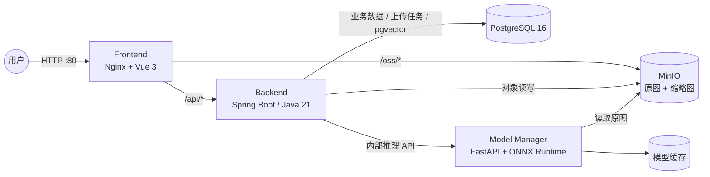

# BaKaBooru

功能和接口索引、架构、数据模型及运维说明见下方文档目录。


一个使用 Docker Compose 自托管的 AI 图库管理系统：支持自动打标、CLIP 语义检索、以图搜图、标签与元数据组合过滤，并将图片和模型保留在自己的基础设施中。

## 核心能力

- **多模态检索**：CLIP 文本/视觉向量配合 pgvector，实现自然语言搜图与以图搜图。
- **自动化入库**：上传后自动计算 SHA-256、查重、解析尺寸、归档原图并生成缩略图。
- **AI 自动标注**：Camie Tagger 识别标签，推理失败可追踪、可手动重试。
- **组合筛选**：按标签、关键字、图片状态、向量模型、宽高、文件大小和排序条件检索。
- **自托管部署**：PostgreSQL、MinIO 和模型推理统一由 Docker Compose 编排。

## 架构概览



Backend 是业务入口；Model Manager 负责打标与向量推理。上传入库和 AI 后处理是两个异步阶段，因此模型加载或暂时不可用时，普通浏览、管理和非语义检索仍能工作。

更完整的服务边界、上传时序与检索路径见[架构设计](docs/architecture.md)。

## 快速开始

### 前置要求

- Docker Compose v2
- NVIDIA Driver 与 NVIDIA Container Toolkit（模型推理需要 CUDA）

### 启动

```bash
cp .env.example .env
# 编辑 .env 并设置本地凭据
docker compose up -d --build --wait
docker compose ps
```

浏览器访问 `http://localhost`。首次运行时模型管理器会下载模型；`--wait` 会在健康检查通过后返回，模型首次下载可能需要数分钟。

> 本地凭据保存在不会提交到 Git 的 `.env` 中。当前 MinIO bucket 会初始化为匿名可读；对外部署前请先阅读[部署指南](docs/deployment.md)。

## 目录结构

```text
bakabooru/
├── backend/               # Spring Boot 业务 API、任务调度和持久化
├── model-manager/         # FastAPI 模型推理
├── frontend/              # Vue 3 + TypeScript
├── docs/                  # 架构、模块、部署和运维文档
├── data/                  # Compose 持久化数据
└── docker-compose.yml     # 完整容器编排
```

## 配置方式

- `.env` 保存 PostgreSQL 与 MinIO 凭据，只用于本地部署且不会提交 Git。
- 服务地址、缩略图规格和 Worker 调度参数由应用提供适合 Compose 的默认值。
- 标签阈值、AI 重试策略和上传任务保留期可在系统设置页中修改并立即作用于后续任务。

部署参数见[部署说明](docs/deployment.md)。

## 文档

| 文档 | 内容 |
| --- | --- |
| [快速开始](docs/getting-started.md) | 首次部署、初始化与常用命令 |
| [功能与 API](docs/features-api.md) | 功能目录和 Backend/Model Manager 接口索引 |
| [架构设计](docs/architecture.md) | 服务边界、一致性原则与关键数据流 |
| [数据模型](docs/data-model.md) | PostgreSQL 实体、状态和 MinIO 对象映射 |
| [部署与配置](docs/deployment.md) | Compose 服务、环境变量、升级与持久化 |
| [运维手册](docs/operations.md) | 健康检查、任务恢复、故障定位与备份 |
| [开发指南](docs/development.md) | 源码位置、本地验证和变更约定 |
