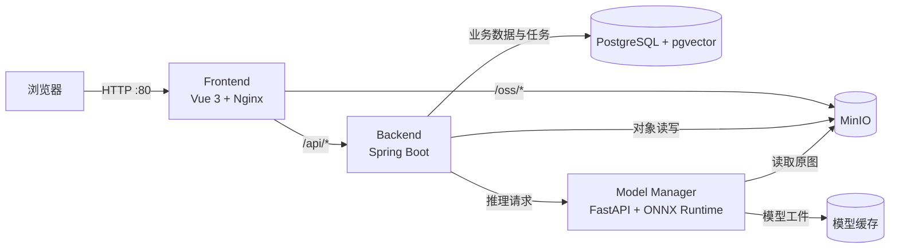
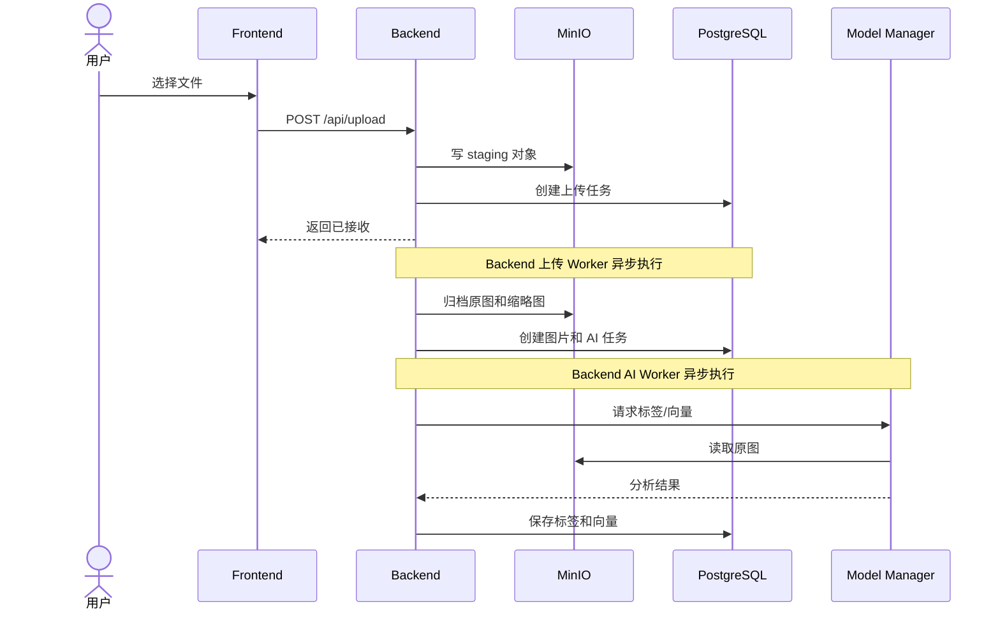

# 架构设计

本文描述系统边界、请求路径和异步处理原则，不列出全部接口或部署参数。接口见[功能与 API](features-api.md)，启动配置见[部署说明](deployment.md)。

## 系统边界

| 组件 | 职责与数据所有权 |
| --- | --- |
| Frontend | 页面与交互；经 Nginx 访问 Backend 和 MinIO 图片代理 |
| Backend | 唯一业务写入入口；拥有鉴权、事务、图片元数据、标签和持久化任务 |
| Model Manager | 无业务数据库的推理进程；读取 MinIO 原图并返回标签/向量 |
| PostgreSQL | 元数据、设置、上传任务、AI 任务和 CLIP 向量的事实来源 |
| MinIO | 上传暂存对象、原图和缩略图 |

## 核心数据流

上传请求将文件写入 MinIO staging 并创建 PostgreSQL 上传任务后即返回。Backend 上传 Worker 归档原图和缩略图、创建图片记录及 AI 任务；AI Worker 再调用 Model Manager，成功后保存分析结果。这两个阶段均由持久化任务驱动。

数据库租约与 `FOR UPDATE SKIP LOCKED` 支持任务崩溃恢复。AI 暂不可用时，任务留在数据库并按退避策略重试，不会阻止普通图库和非语义搜索。

## 搜索路径

- 标签、关键词和元数据筛选由 Backend 查询 PostgreSQL。
- 语义搜索先向 Model Manager 请求文本向量，再由 pgvector 排序。
- 以图搜图先取得图片向量，再由 pgvector 排序。
- 向量按模型存于 `image_embeddings`；数据库结构见[数据模型](data-model.md)。

## 一致性原则

- PostgreSQL 拥有业务状态；Model Manager 不写业务数据库。
- MinIO 对象与数据库记录通过 Backend 的任务流程协调，不使用分布式事务。
- 上传任务状态与图片分析状态分开管理，分别反映文件入库和 AI 分析。
- 模型加载由 Model Manager 管理；其健康检查在初始化完成前失败，Compose 等待就绪。
