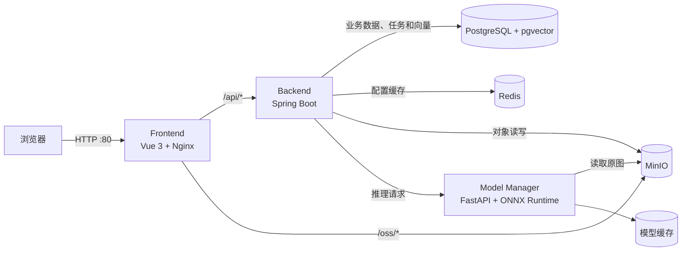
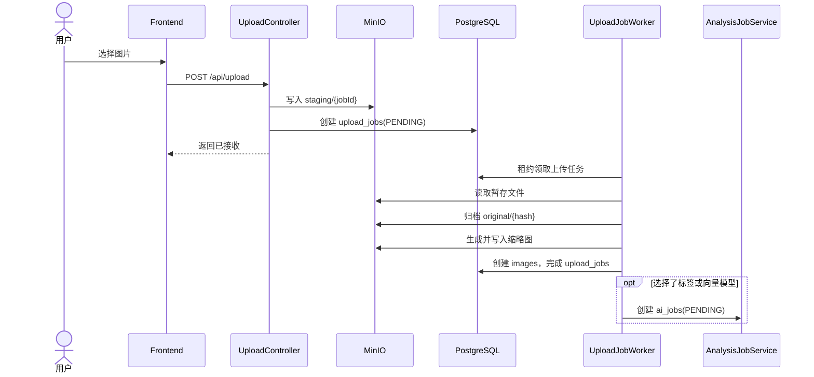
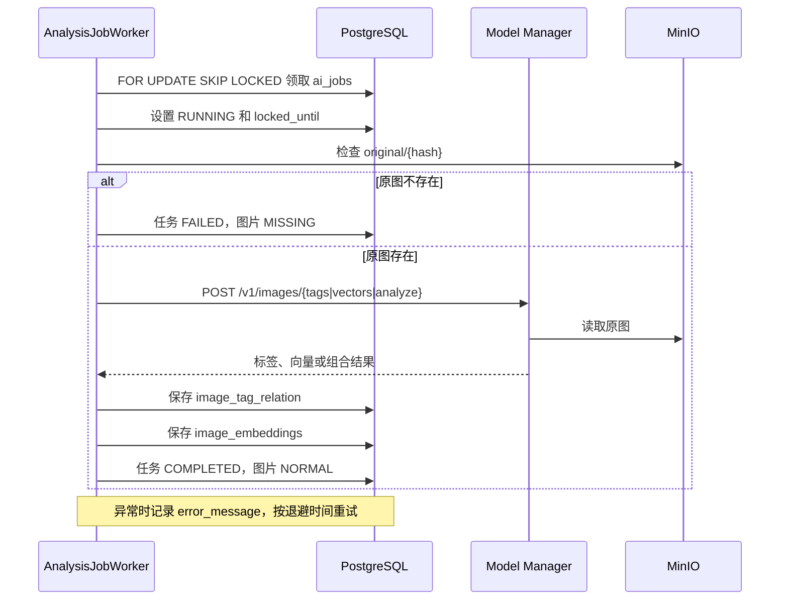
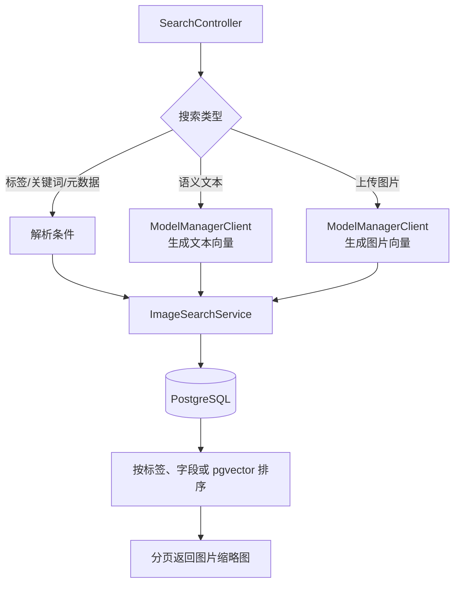
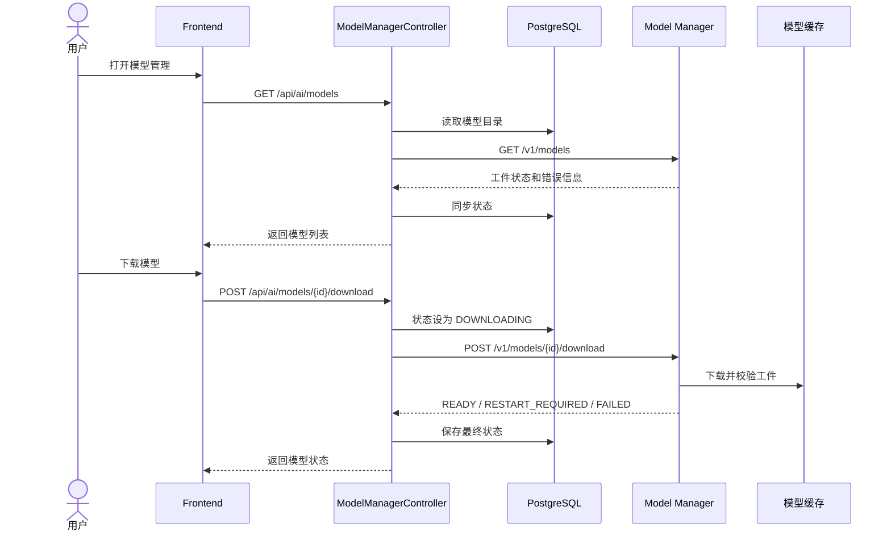
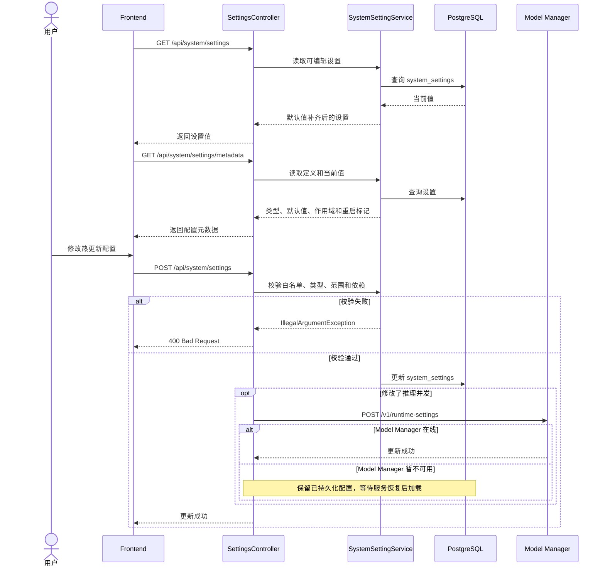

# 架构设计

## 服务边界

| 组件 | 职责 |
| --- | --- |
| Frontend | 页面、交互和 API/图片代理 |
| Backend | 鉴权、事务、图片元数据、标签、模型目录和持久化任务 |
| Model Manager | 无业务数据库的模型加载、标签推理和向量计算 |
| PostgreSQL | 业务数据、系统设置、上传任务、分析任务和向量 |
| MinIO | 暂存文件、原图和缩略图 |

## Backend 模块

- `controller`：HTTP 接入层。`ModelManagerController` 管理模型目录；`ImageAnalysisController` 管理图片分析接口；`ImageController` 只管理图片本身。
- `module.image`：图片实体、标签关系、图片 CRUD、搜索查询和对象存储。
- `module.analysis`：分析请求 DTO、`AnalysisJob`、任务仓储、入队服务和后台 Worker。
- `module.model`：模型实体和目录、`ModelManagerClient`、文本/图片向量服务。
- `module.search`：组合搜索和语义搜索编排。
- `module.upload`：上传任务、文件归档和入库 Worker。
- `module.system`：系统设置、Redis 缓存和认证。

## 核心流程

上传请求先将文件写入 MinIO 暂存区，并在 PostgreSQL 创建上传任务后返回。上传 Worker 归档原图、生成缩略图和图片记录，再创建分析任务。分析 Worker 使用数据库租约领取任务，调用 Model Manager，成功后保存标签和向量；失败任务按退避策略重试。

普通图库查询不依赖模型服务。模型服务不可用时，分析任务保留在数据库中，待服务恢复后继续处理。

## 主要执行流程

### 上传与后台入库

上传接口只负责接收文件和创建任务，文件入库在后台完成。这样接口响应不会等待图片解析、缩略图生成或模型分析。

### 图片分析与重试

分析任务按能力拆分为 `TAGS`、`VECTORS` 或 `TAGS_AND_VECTORS`。Worker 先更新图片分析状态，再调用 Model Manager，成功后将结果写入标签关系和向量表。

### 搜索

标签、关键词和元数据查询直接由 PostgreSQL 完成。语义搜索先把文本交给 Model Manager 生成向量；以图搜图先上传图片到 Model Manager 生成查询向量，然后统一由 `ImageSearchService` 执行 pgvector 相似度查询和分页。

### 模型管理

模型目录由 Backend 的 `ModelManagerController` 对外提供。Backend 保存模型目录和状态，同时从 Model Manager 同步运行时工件状态；下载完成后是否需要重启由 Model Manager 返回的状态决定。

### 配置管理

配置页面先读取可编辑值和配置元数据。更新请求只允许白名单中的热更新配置，Backend 会合并已有值进行类型、范围和依赖校验，再持久化到 `system_settings` 并删除对应 Redis 缓存。Backend 读取配置时先查 Redis，未命中时回源 PostgreSQL 并回填；Model Manager 也按相同键读取 Redis，未命中时通过受保护的内部接口请求 Backend 回源。推理并发配置会同步调用 Model Manager；同步失败不会回滚数据库，界面只提示后续生效。

## 一致性

- PostgreSQL 是业务状态的事实来源，Model Manager 不写业务数据库。
- MinIO 对象和 PostgreSQL 记录由 Backend 任务流程协调，不使用分布式事务。
- 上传状态和分析状态分开记录，分别表示文件入库和模型分析进度。
- `FOR UPDATE SKIP LOCKED` 和租约字段支持 Worker 崩溃恢复。
