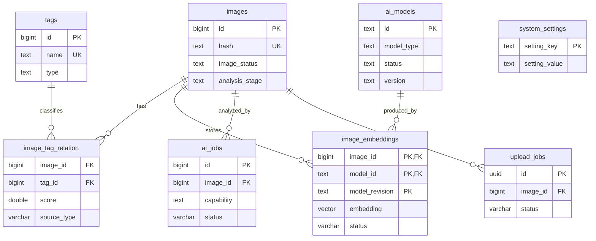

# 数据模型

Backend 使用 PostgreSQL 16 和 pgvector。数据库结构由 `backend/src/main/resources/db/migration` 下的 Flyway 脚本维护；本文描述当前迁移完成后的有效结构，不重复列出历史兼容字段。

## 关系概览

## 业务表

### `images`

图片主记录。`hash` 是 SHA-256，用于去重并对应 MinIO `original/{hash}` 对象；缩略图使用同一哈希命名。

| 字段 | 类型 | 说明 |
| --- | --- | --- |
| `id` | `BIGINT` | 主键 |
| `title`、`file_name`、`extension` | `TEXT` | 展示标题、原始文件名和扩展名 |
| `size`、`width`、`height` | `BIGINT`/`INTEGER` | 文件大小和图片尺寸 |
| `hash` | `TEXT UNIQUE` | 内容哈希 |
| `image_status` | `TEXT` | `NORMAL`、`ANALYZING`、`ERROR`、`MISSING` |
| `view_count` | `BIGINT` | 查看次数 |
| `analysis_stage` | `TEXT` | 当前分析阶段：`TAGS`、`VECTORS` 或 `TAGS_AND_VECTORS` |
| `analysis_error` | `TEXT` | 最近一次分析错误 |
| `analysis_started_at`、`analysis_completed_at` | `TIMESTAMPTZ` | 分析时间 |
| `created_at`、`updated_at` | `TIMESTAMPTZ` | 审计时间 |

### `tags` 与 `image_tag_relation`

`tags` 是全局标签字典，`image_tag_relation` 是图片与标签的多对多关联。关联表的 `(image_id, tag_id)` 唯一，`score` 保存模型置信度或人工标签的默认分数，`source_type` 区分 `MANUAL`、`AI` 和历史数据 `LEGACY`。标签实体归属于 `module.image`。

### `image_embeddings`

图片按模型和版本保存的向量。主键为 `(image_id, model_id, model_revision)`；`embedding` 使用 pgvector，`status` 为 `PENDING`、`PROCESSING`、`READY` 或 `FAILED`。失败信息和计算时间分别保存在 `error_message`、`computed_at`。

### `ai_models`

模型目录和工件状态。`id` 是模型标识，`version` 是模型版本，`model_type` 当前为 `TAGGER` 或 `CLIP`。`status` 为 `NOT_INSTALLED`、`DOWNLOADING`、`RESTART_REQUIRED`、`READY` 或 `FAILED`。模型工件位置、下载地址、校验和及预处理参数分别保存于 `artifact_object`、`download_url`、`artifact_sha256` 和 `preprocessing_json`。

### `ai_jobs`

持久化图片分析任务，由 `module.analysis` 的 Worker 领取和执行。任务通过 `image_id` 关联图片，`capability` 为 `TAGS`、`VECTORS` 或 `TAGS_AND_VECTORS`，`status` 为 `PENDING`、`RUNNING`、`COMPLETED` 或 `FAILED`。`next_retry_at`、`attempts`、`locked_by` 和 `locked_until` 用于重试、租约和崩溃恢复；`tag_model_id`、`vector_model_ids` 保存本次任务选择的模型。

### `upload_jobs`

上传阶段的持久化任务。文件先写入 MinIO 暂存对象，任务成功后创建 `images` 记录并归档原图，再由分析任务处理模型推理。`status` 为 `PENDING`、`PROCESSING`、`COMPLETED` 或 `FAILED`；`staging_object_name` 唯一，`image_id` 在入库完成后回填。

### `system_settings`

键值形式的系统设置表，主键为 `setting_key`。当前运行时键包括 `analysis.tag-threshold`、`analysis.max-attempts`、`analysis.retry-base-delay-seconds`、`analysis.retry-max-delay-seconds`、`upload.completed-retention-days`、`inference.concurrency`、`model.active-tagger-id` 和 `model.active-clip-id`。Redis 只由 Backend 缓存这些值，数据库仍是事实来源；缓存失效后由 Backend 回源并回填。Model Manager 只调用 Backend 内部配置接口，不感知 Redis。

## 一致性与生命周期

- PostgreSQL 是图片、标签、向量、模型目录和任务状态的事实来源；Model Manager 不直接写入业务表。
- MinIO 对象和数据库记录由上传 Worker 协调，不使用分布式事务；失败任务保留在数据库中以便重试。
- 上传任务和分析任务是两个独立生命周期。图片可以已经入库但仍处于 `ANALYZING`，模型服务不可用时任务会按租约和退避策略继续等待。
- 分析 Worker 使用 `FOR UPDATE SKIP LOCKED` 领取任务，并通过 `locked_until` 处理 Worker 崩溃后的重新领取。
- 向量查询按 `image_embeddings.model_id` 选择模型；删除图片会级联删除其向量、标签关联和分析任务。

## 迁移维护

新增字段、约束或索引必须通过新的 Flyway 迁移加入，不能直接修改已执行的历史脚本。删除旧字段时应先在应用代码中完成切换，再增加兼容迁移并验证已有数据转换结果。
