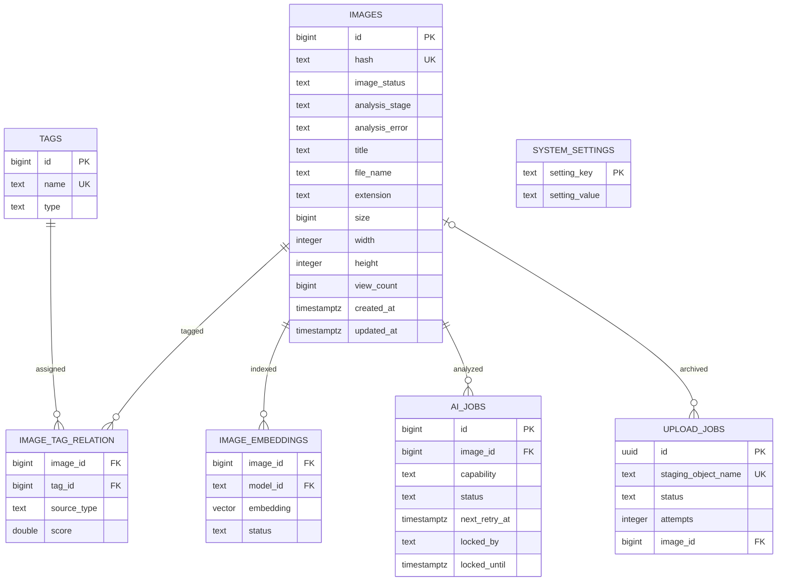

# 数据模型

本文记录当前持久化模型：PostgreSQL 保存业务元数据和任务，MinIO 保存二进制对象。系统边界见[架构设计](architecture.md)，数据库变更由 `backend/src/main/resources/db/migration` 中的 Flyway SQL 管理。

## 关系概览

`system_settings` 保存可编辑运行时设置及认证初始化数据，不与业务实体建立外键。

## 状态与约束

| 实体 | 状态/唯一性 |
| --- | --- |
| `images` | `image_status`: `NORMAL`、`ANALYZING`、`ERROR`、`MISSING`；`hash` 唯一 |
| `image_tag_relation` | 每张图片/标签对唯一；`source_type` 区分 AI 与人工标签 |
| `image_embeddings` | 以图片、模型 ID 和模型版本区分向量；维数由模型定义 |
| `upload_jobs` | `PENDING`、`PROCESSING`、`COMPLETED`、`FAILED`；租约由 `locked_by`、`locked_until` 表示 |
| `ai_jobs` | `PENDING`、`RUNNING`、`COMPLETED`、`FAILED`；按图片与分析能力区分 |
| `ai_models` | 工件状态含 `NOT_INSTALLED`、`DOWNLOADING`、`RESTART_REQUIRED`、`READY`、`FAILED` |

图片状态表示面向图库的总体生命周期，任务状态表示单项工作的执行情况，两者不一一同名映射。

## MinIO 对象布局

| 对象 | 用途 |
| --- | --- |
| `images/staging/{jobId}` | 等待 Backend 入库的上传文件 |
| `images/original/{hash}` | 按 SHA-256 归档的原图 |
| `images/thumbnail/{maxSize}/{hash}.{format}` | 按缩略图启动配置生成的缩略图 |

删除图片和对象由 Backend 协调。数据库备份应与 MinIO 对象备份尽量采用同一恢复点。

## 迁移约定

只追加新的版本化 migration，不修改已在环境执行的 migration。Hibernate 使用 `ddl-auto: validate` 检查映射，不负责自动修改生产表结构。
